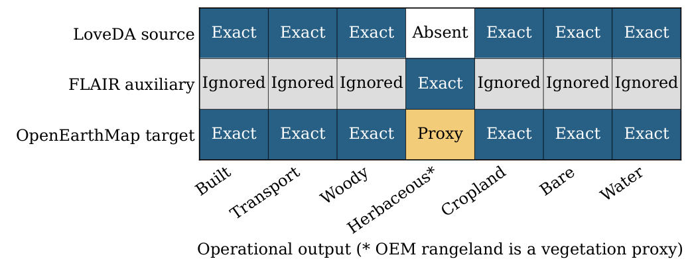
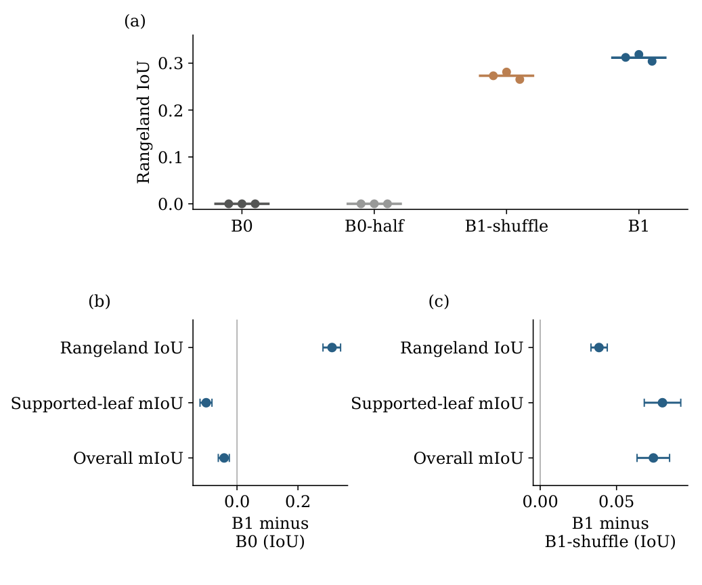
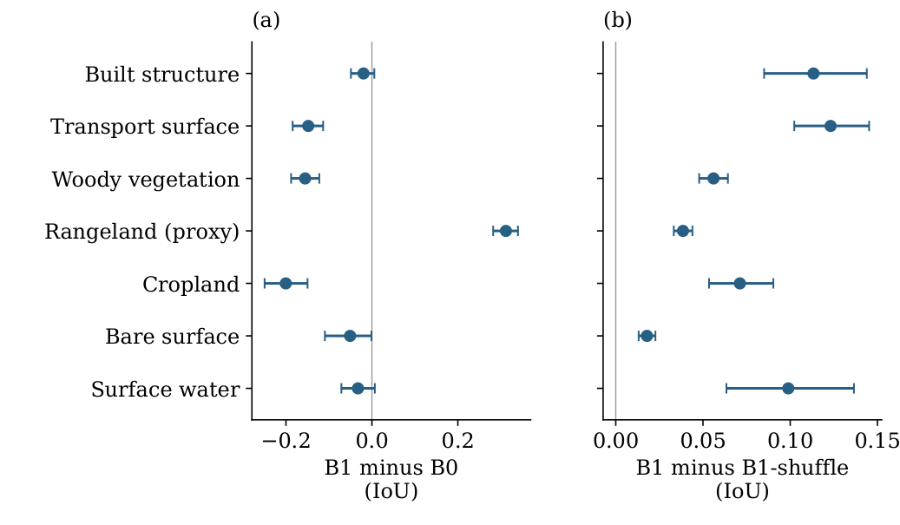

# 跨数据集土地覆盖分割中的源标签覆盖及恢复—保持权衡审计

中文正文研读稿。作者、单位、基金与利益冲突按已确认英文稿保留；实验数值、数学表达及科学范围对应英文40篇引用版。图内英文标签和实际输入的英文提示词保留，图注和表格正文已翻译。

Yangxi Luo（单位1）；Liang Cheng、Jiawen Pan（单位2）

单位1：Fuzhou Polytechnic University, Fuzhou, China。单位2：Fujian Agriculture and Forestry University, Fuzhou, China。

通讯作者：Liang Cheng，52370034073@fafu.edu.cn。

## 摘要

跨数据集语义分割的得分接近零，本身不足以区分影像域偏移与源标注未被分配到待评估输出类别这两种情况。本文结合原始掩膜覆盖审计与固定预算的源数据混合实验考察这一问题，并明确采用七叶类别的操作性映射；其中，OpenEarthMap 的 rangeland 被用作植被代理类别，其原生定义也包含灌木。在主要的 LoveDA—OpenEarthMap 案例中，加入所考察的 FLAIR 草本源数据混合，使 rangeland 的 IoU 提高0.3118，但使六个 LoveDA 支持类别上的 mIoU 降低0.1011。对同一目标数据上的历史原生 ResNet-34 U-Net 记录进行再分析，得到相同方向：rangeland 恢复量为0.2828，支持类别 mIoU 的变化为-0.1304。反向配置的源混合在恢复耕地的同时也产生了支持类别性能损失；Semantic Drone 则提供了主要 CLIP 检查点在另一目标上的评估。这些结果通过特定的经验审计设计补充了已有标签空间与负迁移研究，没有提出新的分割算法或恢复指标。源混合同时改变影像和标签，且历史检查点与排程的来源证据仍不完整。因此，现有证据支持有边界的描述性对比，不能单独识别标签的因果作用，也不能证明已提出成功的缓解方法。正例源标签覆盖、缺失类别恢复与源支持类别保持应当共同报告。

## 引言

土地覆盖模型常在一种制图产品上训练，再在另一种产品上评估。影像、传感器、分辨率与地理区域变化可能影响性能，而不同产品的图例差异也会改变模型实际获得的正例监督[1, 2, 3]。如果某个目标类别在源数据的精确类别标签中缺失，仅凭接近零的目标 IoU 很难解释迁移失败；这不足以证明影像域偏移是唯一原因。

本文将某次映射决策中最细的软件输出类别称为操作性叶类别，并不据此声称已经建立完整一致的植物学分类体系。在明确的类别映射下，目标叶类别可能获得精确源支持、仅获得较粗祖先类别支持，或没有映射支持。这些是监督记录，而非彼此排斥的迁移误差原因。精确标签缺失也不意味着预训练模型不具备该概念的表征，或异质监督无法支持该概念；它只表示指定的源训练掩膜没有提供这一精确叶类别的正例，尽管损失函数仍会影响其预测。

标签空间协调与标注冲突已有研究基础：MSeg 协调类别体系和像素标注，UniSeg 处理多数据集标签偏移[4, 5]。分别报告共同与私有类别性能，以及考察负迁移，也有既有先例[6, 7, 8]。本文的问题更具体：原始掩膜支持审计能怎样改变对某次迁移失败的解释？在固定更新预算和源暴露控制下，所考察的源混合带来多大的恢复收益，又保留了多少源支持类别性能？

在冻结的编码表中，LoveDA 没有被分配到草本输出索引的原始类别，FLAIR 原始 ID 10 则提供该训练分配。OpenEarthMap 的 rangeland 是这一索引所采用的较宽目标代理类别，而非纯草本参考类别（补充材料 S2）。主要 CLIP 实验比较 LoveDA 单源基线与 LoveDA—FLAIR 混合，并保持目标评估总体一致。暴露控制与重复裁块控制约束了 LoveDA 采样量和更新表示的变化。历史原生 U-Net 对比在同一目标上检验另一种记录模型家族中的恢复与保持方向。已记录的错配影像—掩膜配置则提供单独的 CLIP 敏感性分析，其来源证据有限。辅助影像与标签同时进入训练，因此这些源混合对比均不能单独识别标签的因果作用。

本文的贡献是在上述限定条件下开展经验审计与诊断设计：将版本化的操作性类别映射关联到原始掩膜正例支持；在指定控制下同时报告缺失类别恢复与源支持类别损失；并在明确各自依赖关系及来源边界的前提下，考察历史模型家族扩展和反向源混合。主要对比中，rangeland IoU 的差值为+0.3118，支持类别 mIoU 的差值为-0.1011；历史 U-Net 记录重复了这一方向。校准适配器和 U-Net 是测量工具，而非本文提出的新算法。本文不主张首次发现标签不匹配或负迁移，也没有声称已验证解决该权衡的方法。

## 相关工作

#### 图例协调与多数据集标签。

土地覆盖协调处理不同命名体系与制图尺度的不一致[3, 9]。MSeg 进一步协调跨数据集像素标注[4]；UniSeg 建模多数据集标签冲突并学习共享表征[5]。HTSS 预印本通过通用类别体系整合冲突标签空间与不同标注类型[10]。因此，本文不将类别体系统一或异质源学习作为新贡献。本文的操作性审计记录：在指定训练协议实际使用的源掩膜中，映射后的精确标签是否真实出现。

#### 开放集适应与恢复、保持报告。

域适应方法处理表征与输出分布的变化[11, 12, 13, 14]。BUS 和 UniDA-SS 明确处理源与目标类别空间差异，并评估共同与私有类别性能[6, 7]。SATS 预印本也指出已知类别负迁移与未知类别欠拟合[8]。因此，平衡恢复和保持是已有的问题框架。本文估计量针对固定七叶输出空间内一个具名新增类别，使用具有正例的辅助源监督，而非声称提出新的开放集适应方法或指标。本文测量所考察混合的实际收益和损失，不主张优于上述方法。

#### 可迁移土地覆盖语义与非精确指导。

TACOSS 利用文本监督对齐视觉与语义表征，以支持可迁移土地覆盖标签[15]。LandSegmenter 将异质土地利用、土地覆盖监督与灵活语义表征结合[16]。这些是遥感领域超越单一刚性图例的近邻研究。粗粒度或歧义指导本身也是独立学习问题[17, 18]。本文原始掩膜支持计数仅适用于所声明的精确、粗粒度与忽略映射；不能据此认定精确正例标签是学习或识别的普遍必要条件。源混合干预同时改变影像和标签。

#### 近期语义细化与开放词汇分割。

KG-OVRSeg 利用知识图谱关系增强类别表征，以减少遥感分割中的命名和层级歧义[19]。Hierarchical Category Refinement 结合视觉与语义层级信息，研究较粗土地覆盖类别的细化[20]。ROSS 为文本定义的开放词汇分割构建遥感特定表征与聚合机制[21]。这些研究进一步凸显软件标签分配、语义知识和植物学类别身份之间的差别。本文支持指示量仅涉及被纳入的源掩膜标签，不衡量预训练模型编码的全部知识，也不能证明识别必须具有精确目标类别标注。

#### 粗标签与历史产品监督。

CTS-WS 在已有产品监督更高分辨率制图时处理时相标签变化和空间分辨率差异[22]。SAMPLER 在这一由粗到细的场景中结合原型学习、改进的 Segment Anything 模型与标签细化[23]。超像素感知的可信双专家学习则采用超像素训练单元和互补专家估计，处理历史产品标签噪声[24]。这些方法处理标签可靠性和分辨率不匹配。本文审计提出互补问题：保留的源训练协议实际上纳入了哪些精确输出分配？被忽略或未映射的类别，与已纳入类别中的带噪样本，是不同监督记录。本文不对这些算法开展基准比较，也不将其报告收益移入本研究源混合差值。

#### 基础表征下的域泛化。

近期遥感分割研究适配视觉基础模型，并扩展源外观多样性[25]。MetaFD 连续建模域变化并解耦域相关特征[26]；概念引导的域泛化则在微调预训练视觉基础模型时学习语义概念 token，用于未见域的城市场景分割[27]。这些对表征和外观变化的研究与源标签清点互补，不能替代清点。在本文对比中，辅助影像与标签同时改变，这些泛化机制仍可能参与结果，仅凭恢复得分无法分离其作用。因此，当前 CLIP 和历史 U-Net 工具支持有限的家族内部分析，不支持优于当代基础模型方法的结论。

#### 类别空间适应与目标信息要求。

遥感分类中的通用适应已有双分类器一致性与特征混合研究[28]；GLC++ 通过聚类和对比亲和学习处理无源通用域适应[29]。两者提供近期类别偏移先例，但其分类或适应设置与本文稠密、固定输出且辅助源含正例监督的实验不同。遥感分割的单样本适应同样采用不同于本文源混合比较的目标影像制度[30]；此处 one-shot 不能误读为 open-set。本文保留上文中针对分割的共同与私有类别先例，不主张提出新指标或通用适应方法。

#### 实验工具与范围。

CLIP 提供文本定义的类别分数[31]，稠密视觉语言方法将此接口扩展到分割[32, 33, 34]。主要实验冻结 CLIP 编码器，并优化低秩校准头。历史 ResNet-34 U-Net 记录提供卷积模型家族检验[35]；其初始化与优化制度不同于 CLIP。LoveDA、FLAIR 和 OpenEarthMap 定义经验源、目标设置[36, 37, 38]。本文报告家族内部源对比，而非分割排行榜或跨架构的一般性能比较。

## 材料与方法

### 覆盖记录与目标估计量

固定叶类别集合$\mathcal{C}$包含建筑、交通地表、木本植被、草本植被、耕地、裸地和地表水。各数据集的原始标签分别映射到精确叶类别、较粗祖先类别、歧义值或忽略值。精确支持记为

$$
s_d(c)=\mathbb{1}\!\left\{\text{经审计的源训练掩膜中含有类别 }c\text{ 的精确标签}\right\}.\tag{1}
$$

这是明确类别映射下的源标签分配，不意味着不同产品之间具有普遍语义等价性。支持记录中的“精确”表示被纳入的源训练输出分配。目标 rangeland 关系是近似代理，不能证明目标类别在植物学意义上精确对应。对于草本植被，LoveDA 满足$s_d(c^*)=0$，FLAIR 原始 ID 10 则提供正例。主要估计量为配对的目标叶类别差值：

$$
\Delta=\mathrm{IoU}_{\mathrm{B1}}(c^*)-\mathrm{IoU}_{\mathrm{B0}}(c^*).\tag{2}
$$

另将支持类别保持定义为

$$
\mathrm{mIoU}_{\mathrm{sup}}=\frac{1}{|\mathcal{C}_{\mathrm{sup}}|}\sum_{c\in\mathcal{C}_{\mathrm{sup}}}\mathrm{IoU}_c,
\quad \mathcal{C}_{\mathrm{sup}}=\mathcal{C}\setminus\{c^*\}.\tag{3}
$$

原混淆矩阵保持不变：将耕地参考像素预测为草本仍然是错误。总体 mIoU 对全部七个叶类别求平均。IoU 和差值均按0—1尺度报告；例如0.3118的差值表示31.18个百分点，而非相对百分比增幅。

### 数据集与评估总体

LoveDA 提供2,522对训练影像和1,669对验证影像[36]，其六个非背景类别映射到六个非草本叶类别。FLAIR 提供高分辨率航空影像和土地覆盖标注[37]；本文使用 FLAIR #1 版本及其文档标签定义[39]。保留的原始掩膜清单包含61,712对栅格，其中47,712对用于训练或优化，14,000对用于验证。B1 使用 RGB 通道0—2，并仅纳入原生草本 ID 10；其余 FLAIR 标签全部忽略。数据角色和经审计的总体计数见表1。

**表1 冻结操作性映射下的数据集、经审计输出标签支持及目标代理，以及受控研究中的数据角色。未在本地证据归档中验证的数据采集元信息不列入。**
| 数据集 | 角色 | 输出支持或代理 | 总体 | 本文用途 |
| --- | --- | --- | --- | --- |
| LoveDA | 源 | 缺少精确操作性叶类别 | 2522对训练数据 | 无草本监督的主要源 |
| FLAIR | 辅助源 | 原始 ID 10，声明操作性关系 | 47712对训练数据 | 原始 ID 10 进入 B1；其余 ID 忽略 |
| OpenEarthMap | 主要目标 | rangeland 植被代理 | 排除 Paris 后74城 | 主要评估总体 |
| Semantic Drone | 第二目标 | grass | 冻结清单内400张栅格 | 第二目标评估 |

主要目标数据为 OpenEarthMap[38]：共发现75个城市中的2,687对 RGB 影像与掩膜，另有813个仅标签掩膜被排除。移除 Paris 的49对数据后，剩余74个城市的2,638对数据。排除 Paris 是保守的源国家重叠防护；缺少可用 FLAIR 地理标签，因此不能声称已在坐标层面证明不重叠。在明确的类别映射下，OpenEarthMap rangeland 被用作非耕地草本输出的操作性代理，尽管其原生定义还包含灌丛和灌木。Semantic Drone grass 也映射到该输出。Agriculture_land 保持为独立耕地关系，developed space 保持为较粗祖先类别。这些是基于原生标签的协议映射，而非植物学范围完全一致的断言。具体边界见英文补充材料 S2。

Semantic Drone 提供400对栅格上的第二目标评估[40]。草地采用一对其余评分：发布的 grass 参考颜色对应正例，所有其他参考颜色均为负例，因此把非草地预测为草地会产生假阳性。其他类别不单独取平均；这不是官方全类别基准分数。标识符000—003曾用于流程冒烟测试；400张栅格结果为主要结果，排除这四张后的396张结果为探索性结果。第二个源混合案例则使用 Semantic Drone grass/tree/water 训练，并加入 LoveDA 耕地监督。该案例的 OpenEarthMap 评估排除 Shanghai、Tyrol 和 Vienna，保留72个城市中的2,540对数据；由于没有使用 FLAIR，Paris 被保留。这是同一目标版本上的反向源混合检验，并非独立目标配对复现。

原始掩膜审计记录标识符、配对、被纳入的标签和像素支持。精确、粗粒度与忽略标签分别记录，不将宽泛植被类别默认为精确草本类别。本文报告历史固定检查点之间的差值，并非对一个事前从未接触的目标开展确认性检验。总体定义需同时说明目标相关检查和地理限制。

### 固定探针、训练与对比

CLIP ViT-B/16 的影像和文本编码器均冻结[31]。归一化图像块特征和文本特征$\mathbf z_{hw},\mathbf t_c$经秩32投影校准：

$$
\ell_c(h,w)=\tau\mathbf z_{hw}^{\mathsf T}\mathbf t_c+
\alpha\frac{\langle\mathbf W_I\mathbf z_{hw},\mathbf W_T\mathbf t_c\rangle}{\sqrt{32}}.\tag{4}
$$

仅优化投影和标量参数。共享提示词和推理细节见附录A及英文补充材料 S3—S4。固定预算源混合分支使用512像素裁块、AdamW、学习率$10^{-3}$、权重衰减$10^{-4}$、25,220次更新，以及随机种子19/37/73。映射后的部分标签$y$具有损失

$$
\mathcal L(x,y)=-\log\sum_{c\in\mathrm{Desc}(y)}p(c\mid x).\tag{5}
$$

忽略像素不贡献损失。精确标签只有一个后代；粗类别约束相容的后代集合，但不分配精确叶类别正例。

表2定义各分支。B0 每次更新使用两个 LoveDA 裁块；B0-half 使用一个；B1 使用一个 LoveDA 裁块和一个 FLAIR 裁块。B1—B0 同时改变辅助影像与标签。B1—B0-half 匹配 LoveDA 暴露量，但仍是源混合对比，而非仅标签干预。确定性的重复裁块分支在附录A所述条件下检查更新实现。

**表2 冻结实验变体和源裁块。已记录 B1-shuffle 配置要求采用 B1 的 FLAIR 影像列表、同区域非原生掩膜，并保持密度多重集；完整主要排程仍不可得，无法独立重新验证。B2 优化与测试城市互斥。B2 使用单独的20轮直接监督可学习性排程，不与其他分支构成固定预算对比。**
| 分支 | 预算 | 每次源裁块 | LoveDA 暴露 | 种子 | 角色 |
| --- | --- | --- | --- | --- | --- |
| E0 | 0次更新 | 无 | 0 | 冻结检查点 | 探针诊断 |
| B0 | 25,220次更新 | 2 LoveDA | 50,440 | 19, 37, 73 | LoveDA 基线 |
| B0-half | 25,220次更新 | 1 LoveDA | 25,220 | 19, 37, 73 | 暴露控制 |
| B1 | 25,220次更新 | 1 LoveDA + 1 原生 FLAIR 草本（ID 10） | 25,220 | 19, 37, 73 | 辅助训练 |
| B1-shuffle | 25,220次更新 | 1 LoveDA + 1 错配 FLAIR 草本（ID 10） | 25,220 | 19, 37, 73 | 原生配对控制 |
| B2 | 20轮 | OpenEarthMap 优化城市 | 不适用 | 19, 37, 73 | 直接支持控制 |
| E3 | 非主要结果 | 源域保形路由诊断 | 不适用 | 不适用 | 层级负对照 |

注：B0-half-batch2 在两个批槽内重复相同的确定性 LoveDA 裁块并取平均损失。其相对 B0-half 的差值在报告精度下为零（附录表A.2），用于流程完整性检查，不是方法分支。E3 按源层级路由像素而不补全目标叶类别，仅保留为负对照。

已记录的 B1-shuffle 配置要求保留 FLAIR 影像排程、使用同区域非自身掩膜，并保持掩膜密度多重集。完整的、可由哈希定位的主要排程在当前证据包中不可得，因此这些约束未得到独立重新验证。原生 B1 减去 B1-shuffle 仅作为基于配置的配对敏感性，不能作为完整验证的配对干预或恢复成因分解。历史配置没有记录逐配对密度的数值容差；描述性错配和已停用的第二案例 shuffle 对比见英文补充材料 S10。对于反向混合，SD-B0 使用两个 Semantic Drone 裁块，SD-B0-half 使用一个，SD-B1 使用一个 Semantic Drone 裁块和一个 LoveDA 裁块，固定预算设置相同。其 shuffle 分支在所记录的错配审计后不再用于效果解释。

B2 是独立的直接监督可学习性诊断，采用20轮训练，以及城市互斥的 OpenEarthMap 优化、验证和测试划分。留出总体包含16个城市和595张栅格。它不是预算匹配的外部迁移对比。E0 为冻结探针诊断，E3 为层级路由负对照，二者均不是针对所观察权衡提出的补救方法。

### 历史原生模型家族检验

另对历史原生 ResNet-34 U-Net 记录进行再分析，其编码器采用 ImageNet 初始化，解码器采用 GroupNorm，编码器 BatchNorm 运行统计保持冻结。已记录的原生 U-B0、U-B0-half 和 U-B1 在自身队列内部采用相同的 LoveDA/FLAIR 角色、512像素裁块、AdamW、学习率$10^{-3}$、权重衰减$10^{-4}$、25,220次更新及种子19/37/73。U-B0 每次使用两个 LoveDA 裁块，U-B0-half 使用一个，U-B1 使用一个 LoveDA 裁块和一个 FLAIR ID-10 裁块。九组保留评估与主要 CLIP 对比使用相同的、排除 Paris 后74城2,638个目标标识符；这些历史记录的逐栅格参考类别边际计数一致。

这是对已保存混淆矩阵与运行记录的回顾性分析。源审计内容通过与九份配置中记录的摘要相等而恢复；不同日期的文件名不能证明历史路径、时间或实际使用。九个原始检查点文件随后从保留归档找回，其 SHA256 摘要与原始评估配置完全相同。空间影像与掩膜同一性、历史初始化和实际执行代码身份未重新验证，也未开展模型推理重放。本文重构全部原生指标及配对的2,000次城市重采样区间（种子20260803），这些区间以记录的检查点为条件。U-Net shuffle 不用于效果解释。预训练表征和优化制度不同，不能将 CLIP—U-Net 的指标差异解释为架构优越性。九个原生检查点数值及来源限制见英文补充材料 S12。

### 推理、汇总与不确定性

栅格采用不重叠的512像素瓦片评估，边缘补零，logit 双线性上采样，再在未填充区域取 argmax。不使用测试时增强或后处理。各类 IoU 为$TP/(TP+FP+FN)$。对每个检查点先汇总城市混淆矩阵，再计算 IoU；点估计为三个匹配检查点指标的平均值。主要源混合与暴露对比使用2,000组共享城市抽样（NumPy 种子20260803），配对控制对比使用种子20260806。历史种子19的 Semantic Drone 敏感性使用2,000次配对栅格抽样（种子20260804）；本稿中的三个检查点点值为描述性结果，不提供独立重构的栅格区间。反向源案例使用2,000次城市抽样（种子20260815）。百分位区间以已完成检查点和指定评估单位为条件，不估计训练种子不确定性，也不建立 Semantic Drone 站点层面的独立性。估计方法和诊断细节见英文补充材料 S6—S10。

### AI 辅助准备

OpenAI Codex 用作开发与写作助手，辅助代码草拟、文献检索、历史记录整理与重算、图表准备及稿件修订。性能差值由保留的原始整数记录计算；补充归档检查读取保留的检查点与提供方文件。生成文本不被视为实验证据。本地审计轨迹中的代理检查属于软件辅助、同模型家族的暂定审查，不替代独立人工同行评审或作者责任。本文不声称已证明所用助手的精确模型版本。

## 结果

### 审计识别出一个缺少源支持的目标叶类别

图1概括操作性覆盖记录。LoveDA 为六个叶类别提供精确的操作性支持，但不包含草本植被。FLAIR 原始 ID 10 提供所声明的辅助草本标签，其余 FLAIR 标签在 B1 中均被忽略。在冻结映射下，OpenEarthMap rangeland 和 Semantic Drone grass 被声明为同一非耕地草本概念所对应的目标类别。数据总体和源角色见表1。

**图1 主要源混合与 OpenEarthMap 目标的操作性覆盖。Exact 表示原始标签在固定映射下被分配到相应公共叶类别，不表示普遍语义等价。LoveDA 没有被纳入草本输出的源标签。B1 保留 FLAIR 原始 ID 10，忽略其余标签。OEM 的 Proxy 单元反映 rangeland 包括灌木的较宽定义（英文补充材料 S2）。Semantic Drone 单独按草地对全部其他像素评估（第4.6节）。**

### 加入 FLAIR 辅助源能够恢复 OpenEarthMap rangeland

主要对比中最大的变化集中在经审计缺失的叶类别。种子19、37、73的三个固定检查点上，B0 rangeland IoU 分别为$1.6\times10^{-7}$、0、0，B1 则为0.3124、0.3187、0.3041。在排除 Paris 的74城总体上，配对平均差值为+0.3118，95%评估单位 bootstrap 区间为[+0.2821, +0.3399]（表3、图2）。该区间对所声明城市单位重采样，并以已完成检查点为条件。

**图2 排除 Paris 后74城总体上的 OpenEarthMap 结果。（a）种子19、37、73的 rangeland IoU，水平短线表示均值，横向偏移用于区分检查点。（b）B1 减 B0。（c）B1 减已记录的 B1-shuffle 配置。（b）和（c）采用不同坐标范围，显示2,000次配对城市重采样得到的95%区间，以三个已完成检查点为条件。支持类别 mIoU 对六个 LoveDA 支持类别平均。完整原始 shuffle 排程未找回，因此（c）仅是基于配置的敏感性，而非完整重验证的配对机制。**

仅减少 LoveDA 暴露量不能重复目标叶类别的恢复。相对 B0，B0-half 总体 mIoU 降低0.0069；在匹配 LoveDA 暴露后，B1 的 rangeland 收益仍为+0.3118（表4）。重复裁块完整性检查在所报告精度下为零，见附录表A.2；它检查更新实现，而不是一般性的批大小效应。

### 对已记录配对配置的敏感性

历史 B1-shuffle 配置要求采用相同的 FLAIR 影像排程和掩膜密度多重集，但使用非原生配对掩膜。完整原始排程未找回，因此这些约束无法独立重新验证。该配置仍能恢复 rangeland，三个种子的 IoU 分别为0.2732、0.2812、0.2653。相对 B0 的平均差值为0.2732，而 B1—B0 为0.3118。因此，0.2732/0.3118 = 87.6%的观察恢复量保留在该错配排程中；原生 B1 配置再提高+0.0385（12.4%；95%评估单位 bootstrap 区间[+0.0333, +0.0439]），三个种子的配对差值均为正。同一对比中，总体 mIoU 提高+0.0741，六个 LoveDA 支持类别 mIoU 提高+0.0801（表4）。这一算术划分仅描述指定排程，不分离辅助影像内容和标签支持。由于主要原始排程无法独立重新验证，本文将其作为基于配置的敏感性，而非完整验证的配对机制。

**表3 排除 Paris 后74城 OpenEarthMap 各固定检查点指标。数值显示四位小数；种子19的 B0 rangeland IoU 为$1.6\times10^{-7}$，种子37和73为零。B0 与 B1 的支持类别 mIoU 范围分别为0.4359—0.4468与0.3309—0.3473。支持类别 mIoU 对六个具有 LoveDA 精确操作性支持的类别平均，与总体 mIoU 并列报告，而非另一总体性能估计。城市 bootstrap 差值根据未舍入检查点指标计算，仅展示时舍入（表4）。**
| 分支 | 种子 | 总体 mIoU | Rangeland IoU | 支持类 mIoU |
| --- | --- | --- | --- | --- |
| B0 | 19 | 0.3830 | 0.0000 | 0.4468 |
| B0 | 37 | 0.3802 | 0.0000 | 0.4436 |
| B0 | 73 | 0.3736 | 0.0000 | 0.4359 |
| B0-half | 19 | 0.3652 | 0.0000 | 0.4261 |
| B0-half | 37 | 0.3825 | 0.0000 | 0.4462 |
| B0-half | 73 | 0.3683 | 0.0000 | 0.4296 |
| B1-shuffle | 19 | 0.2710 | 0.2732 | 0.2707 |
| B1-shuffle | 37 | 0.2564 | 0.2812 | 0.2523 |
| B1-shuffle | 73 | 0.2604 | 0.2653 | 0.2596 |
| B1 | 19 | 0.3400 | 0.3124 | 0.3446 |
| B1 | 37 | 0.3292 | 0.3187 | 0.3309 |
| B1 | 73 | 0.3411 | 0.3041 | 0.3473 |

**表4 排除 Paris 后74城 OpenEarthMap 固定预算和错配配对控制差值。区间为以已完成固定检查点为条件的配对城市 bootstrap 区间。差值使用未舍入检查点指标计算，仅展示时舍入。重复裁块完整性检查见附录表A.2。**
| 对比 | 指标 | 估计 | 95%下界 | 95%上界 |
| --- | --- | --- | --- | --- |
| B0-half $-$ B0 | 总体 mIoU | $-0.0069$ | $-0.0100$ | $-0.0038$ |
| B1 $-$ B0 | 总体 mIoU | $-0.0422$ | $-0.0613$ | $-0.0252$ |
| B1 $-$ B0 | rangeland IoU | $+0.3118$ | $+0.2821$ | $+0.3399$ |
| B1 $-$ B0-half | 总体 mIoU | $-0.0352$ | $-0.0538$ | $-0.0182$ |
| B1 $-$ B0-half | rangeland IoU | $+0.3118$ | $+0.2821$ | $+0.3399$ |
| B1 $-$ B0 | 支持类 mIoU | $-0.1011$ | $-0.1213$ | $-0.0821$ |
| B1 $-$ B0-half | 支持类 mIoU | $-0.0931$ | $-0.1128$ | $-0.0741$ |
| B1 $-$ B1-shuffle | 总体 mIoU | $+0.0741$ | $+0.0634$ | $+0.0848$ |
| B1 $-$ B1-shuffle | 支持类 mIoU | $+0.0801$ | $+0.0682$ | $+0.0921$ |
| B1 $-$ B1-shuffle | rangeland IoU | $+0.0385$ | $+0.0333$ | $+0.0439$ |

### 恢复伴随源支持类别性能损失

目标叶类别的收益没有改善完整运行表现。B1 平均 mIoU 为0.3368，B0 为0.3789；对六个具有 LoveDA 精确操作性支持的类别，mIoU 变化为-0.1011（95%评估单位 bootstrap 区间[-0.1213, -0.0821]）。这两个指标回答不同问题：总体 mIoU 包含恢复后的 rangeland，支持类别指标则排除该类，单独报告 LoveDA 原有类别保持。两者的数值差异不是相互竞争的效应量估计。B0 各种子支持类别 mIoU 为0.4359至0.4468，B1 为0.3309至0.3473（表3）；推断仍基于城市单位 bootstrap，而非三个种子的显著性检验。匹配 LoveDA 暴露后，B1—B0-half 的支持类别差值为-0.0931（表4）。图3展示逐类模式：rangeland 恢复，但观察到的支持类别最大下降出现在耕地。完整、未调整的描述性区间见附录表A.3。

**图3 排除 Paris 后74城总体上的 OpenEarthMap 逐类差值。（a）B1 减 B0；（b）B1 减已记录的 B1-shuffle。两个面板采用相同的七个类别行，报告2,000次配对城市重采样的95%描述性区间，以检查点19、37、73为条件。（b）为基于配置的敏感性：完整原始 shuffle 排程未找回，无法独立重验证配对与暴露约束。两个面板横轴尺度不同。**

### 历史原生 U-Net 对比重复了相同方向

在三个历史原生 U-Net 检查点上，U-B0 与 U-B0-half 的 rangeland IoU 均为零。U-B1 分别为0.2957、0.2767、0.2762，平均0.2828，样本标准差0.0111。U-B1—U-B0 的差值为+0.2828（以检查点为条件的95%配对城市区间[+0.2512, +0.3133]）。支持类别 mIoU 从0.2329变为0.1025，差值-0.1304（区间[-0.1529, -0.1075]）；相对 U-B0-half 的差值为-0.1182（区间[-0.1390, -0.0965]）。与两个原生基线比较时，每个匹配种子均表现为 rangeland 恢复为正、支持类别 mIoU 下降（表5）。

因此，历史评估记录在共同目标上的第二种记录架构中显示了恢复与保持损失并存。它们没有提供独立目标总体、纯标签因果实验或 CLIP—U-Net 优越性比较。原始检查点、空间参考与历史代码的来源限制仍如第3.4节所述。U-Net shuffle 结果不参与该结论。

**表5 同一排除 Paris 后74城 OpenEarthMap 目标（2,638张栅格）上的历史原生 U-Net 对比。均值与样本标准差汇总三个已记录种子检查点，标准差为描述性统计。差值使用2,000次配对城市抽样，95%区间以固定记录检查点为条件，不代表训练种子不确定性。支持类别 mIoU 对六个 LoveDA 支持类别平均。U-B0-half 匹配 U-B1 的 LoveDA 暴露量。未重放原始检查点和空间参考字节；这是家族内部的历史记录对比。**
| 分支 | Rangeland IoU | 支持类 mIoU | 总体 mIoU |
| --- | --- | --- | --- |
| U-B0 | $0.0000 \pm 0.0000$ | $0.2329 \pm 0.0158$ | $0.1996 \pm 0.0136$ |
| U-B0-half | $0.0000 \pm 0.0000$ | $0.2207 \pm 0.0261$ | $0.1892 \pm 0.0223$ |
| U-B1 | $0.2828 \pm 0.0111$ | $0.1025 \pm 0.0209$ | $0.1283 \pm 0.0190$ |

| 对比与指标 | 估计 | 95%下界 | 95%上界 |
| --- | --- | --- | --- |
| U-B1 $-$ U-B0 / rangeland | $+0.2828$ | $+0.2512$ | $+0.3133$ |
| U-B1 $-$ U-B0 / 支持类 | $-0.1304$ | $-0.1529$ | $-0.1075$ |
| U-B1 $-$ U-B0-half / rangeland | $+0.2828$ | $+0.2512$ | $+0.3133$ |
| U-B1 $-$ U-B0-half / 支持类 | $-0.1182$ | $-0.1390$ | $-0.0965$ |

### Semantic Drone 上的第二目标评估

在主要400张栅格评估中，冻结 E0 的 grass IoU 为0.0224，三个仅用 LoveDA 的 B0 检查点均为0.0000。三个 B1 检查点分别为0.2282、0.2305、0.2228（均值0.2272，样本标准差0.0040）。描述性的 B1—B0 平均差值为+0.2272（英文补充材料 S9 和 S11）。本稿不主张具有三个检查点的栅格重采样区间。E0 到 B0 的下降是检查点诊断，与仅用 LoveDA 校准抑制冻结探针已有的有限 grass 分数相一致，但不能识别具体机制。这是主要源混合在第二目标上的评估，并非模型层面的独立复现，因为它复用了探针、提示词和训练预算。历史记录指明目标清单与源归档哈希，但本文未建立具有独立时间戳的推理前来源证据。

### 第二种源混合呈现相同的恢复—损失方向

源角色反向配置从另一个经审计缺口出发：Semantic Drone 没有精确的操作性耕地标签，而 LoveDA agriculture 和 OpenEarthMap agriculture_land 提供所声明的耕地关系。在冻结的72城 OpenEarthMap 总体上，SD-B0 与暴露匹配的 SD-B0-half 在每个种子上的耕地 IoU 均为零。SD-B1 为0.1627、0.1642、0.1627，平均配对 SD-B1—SD-B0 差值为+0.1632（95%评估单位 bootstrap 区间[+0.1262, +0.2049]；表6）。

恢复同样伴随固定预算下的代价。在三个具有 Semantic Drone 精确操作性支持的叶类别上，SD-B1 相对 SD-B0 的基础源 mIoU 变化为-0.1686（95%评估单位 bootstrap 区间[-0.1903, -0.1464]），相对暴露匹配 SD-B0-half 为-0.1337（区间[-0.1534, -0.1151]）。原计划的辅助掩膜 shuffle 分支满足多重集和无原生配对约束，但运行后排程审计发现逐配对密度错配，因而停用该对比，不解释其效果。该案例考察第二种经审计源混合，不构成第二个配对控制结果或独立目标配对复现。

**表6 第二源混合评估：Semantic Drone 为基础源，LoveDA agriculture 为提供耕地监督的辅助源，OpenEarthMap 为目标。基础源指标对三个具有 Semantic Drone 精确操作性支持的类别平均：草本植被、木本植被与地表水。点值对三个已完成检查点平均。差值由未舍入指标计算，仅展示时舍入。区间采用2,000次配对城市 bootstrap，以这些检查点及排除 Shanghai、Tyrol、Vienna 后72城总体为条件。**
各检查点的耕地 IoU 与均值
| 分支 | 种子19 | 种子37 | 种子73 | 均值 |
| --- | --- | --- | --- | --- |
| SD-B0 | 0.0000 | 0.0000 | 0.0000 | 0.0000 |
| SD-B0-half | 0.0000 | 0.0000 | 0.0000 | 0.0000 |
| SD-B1 | 0.1627 | 0.1642 | 0.1627 | 0.1632 |

| 分支 | 基础源 mIoU | 角色 |
| --- | --- | --- |
| SD-B0 | 0.2686 | 基础源 |
| SD-B0-half | 0.2337 | 暴露控制 |
| SD-B1 | 0.1001 | 辅助耕地源 |

| SD-B1 减 SD-B0 | 估计 | 95%下界 | 95%上界 |
| --- | --- | --- | --- |
| 耕地 IoU | +0.1632 | +0.1262 | +0.2049 |
| 基础源 mIoU | -0.1686 | -0.1903 | -0.1464 |

三个检查点各自的耕地差值均为正。

独立的 B2 可学习性诊断见英文补充材料 S8 和 S11；这些诊断不选择或改变主要源混合端点。

## 讨论

### 既有问题中的经验诊断

图例相容性、异质标注和类别空间差异均有既有研究基础[3, 4, 5]。TACOSS 与 LandSegmenter 也研究可迁移土地覆盖语义[15, 16]。本文的贡献是有明确边界的经验审计：把声明的类别映射关联到特定学习器实际可用的掩膜，再在指定控制下报告所考察源混合的恢复与源支持类别损失。本文不主张首次提出类别体系构建或发现负迁移。

精确标签缺失限定了可用监督，但并不排除影像偏移，不能确定失败的唯一原因，也不意味着预训练或异质监督模型无法识别该概念。主要 CLIP 对比和历史原生 U-Net 对比在各自记录的训练制度下呈现相同方向。这一扩展缩小了仅归因于单一 CLIP 校准工具的解释范围，但同一目标上的两个选定模型家族并不足以证明架构层面的普适性。

### 源混合与配对能够支持什么结论

主要实验同时加入 FLAIR 影像和草本标签。暴露控制与重复裁块控制约束两种替代解释，但不能将该对比变为仅标签干预。已记录的错配配置保留大部分恢复，原生 B1 只进一步增加较小差值。缺少完整主要排程限制了配对与暴露约束的独立核验。辅助影像内容、区域统计以及同区域错排中的弱对齐仍是相容解释。保留恢复比例只是算术描述，并非归因于某组件的因果百分比。已停用的 U-Net 与反向源 shuffle 分支不提供进一步效果证据。

缺失类别获得收益并不等于总体迁移更好，也不等于保留既有能力。适应研究已报告共同与私有类别性能，并考察已知类别负迁移[6, 7, 8]。本文的损失涉及六个 LoveDA 精确支持类别，或反向案例中的三个 Semantic Drone 精确支持类别。决策边界变化、源外观、采样与损失权重均可能参与其中。实验未证明表征容量是原因，也未验证缓解模块。

### 复现与来源证据边界

Semantic Drone 使用主要 CLIP 检查点提供第二目标评估，但其草地对其余像素指标不衡量全部支持类别保持。反向源案例改变缺失类别，却复用 OpenEarthMap 目标版本。原生 U-Net 记录改变架构，但保持主要目标总体。这些是共享部分组件的互补检验，而非完整独立的架构与目标交叉复现。B2 证明另一直接监督制度下的可学习性，不能证明外部迁移优越性。

Semantic Drone 三个检查点的点值可以从历史整数总计重构，但两个检查点的逐栅格记录未找回，因此不使用历史多检查点区间。原生 U-Net 标识符集合和逐栅格参考边际与主要总体一致，并不因此验证空间标签相同或原检查点实际执行。源就绪审计内容通过哈希恢复，不恢复历史时间戳或实际执行代码身份。城市与栅格区间以记录检查点为条件，不代表训练种子不确定性，也不证明 Semantic Drone 地理站点独立。地理排除降低已知重叠风险，却不能证明坐标级分离。在上述边界内，部署报告仍可明确呈现所考察缺失类别收益及其源支持类别损失。

### 类别代理与构念效度边界

固定编码表不会使原生标注意义自动相同。OEM rangeland 包含灌丛与灌木，因此分配到草本输出时只是较宽的植被代理（英文补充材料 S2）。报告的 rangeland 恢复仍是在声明映射下的原生标签得分，不证明仅对纯草本像素的恢复。保留的 OEM 参考标签不提供草本与灌木的细分。因此，本体分辨率和标注范围仍可能与影像、监督共同影响结果。本文保留原始映射、提示词、检查点和整数分数，不合成新的植物学参考，也不通过改变模型选择来处理这一限制。

## 结论

在明确的操作性类别映射下，原始掩膜审计表明，主要 LoveDA 源缺少精确草本监督。在指定 CLIP 探针和更新预算下，加入所考察的 FLAIR 源混合能够恢复 OpenEarthMap rangeland 性能，但同时降低源支持类别性能。历史原生 U-Net 记录在同一目标上重复了这一方向；另一目标上的评估和反向源混合，则在各自明确的依赖关系与来源限制内扩展了描述性证据。这些结果为已有标签空间和负迁移研究补充了具体的审计与受控经验分析。正例源标签覆盖、缺失类别恢复和源支持类别保持应当共同报告。现有实验既不能单独识别标签的因果作用，也没有证明已经解决这一权衡。

## 利益冲突声明

作者声明不存在与本研究有关的利益冲突。

## 代码与数据可用性

LoveDA、FLAIR、OpenEarthMap 和 Semantic Drone 可依照正文所引原始提供方的条款获取。本地审稿材料不重新分发提供方影像和空间掩膜。已准备的本地代码与结果包包含分析脚本、本体映射、原始标签审计记录、运行配置、标识符与参考计数记录、保留的整数混淆矩阵及 SHA256 清单。独立的本地检查点归档包含九个找回的原生 ResNet-34 U-Net 检查点，每个文件均与原始评估配置记录的摘要一致。这些字节核对不构成模型推理重放，也不验证历史初始化、空间掩膜同一性或实际执行代码的来源。完整的主要配对排程和两个 Semantic Drone 检查点的逐栅格记录在已搜索材料中仍不可得，相应结论与区间已据此限定。代码与保留的分析记录公开于[https://github.com/Loquat-0813/landcover-transfer-audit](https://github.com/Loquat-0813/landcover-transfer-audit)。仓库提供文件清单、核验命令及证据限制说明，不重新分发提供方数据集或模型检查点。持久归档标识尚未分配。

## 致谢

本研究得到福建省自然科学基金（项目编号2026J001311）与国家留学基金管理委员会（项目编号2023063508）支持。OpenAI Codex 辅助了代码草拟、文献检索、保留实验记录的整理与重算、图表制作，以及稿件起草和修订。署名作者负责核查和批准所有科学表述及最终稿件。具体使用范围见第3.6节。

## 可复现性与完整性条件

冻结类别体系包含七个叶类别：建筑、交通地表、木本植被、草本植被、耕地、裸地和地表水。草本植被是冻结输出索引的名称；其 OEM 目标关系是范围较宽、包含灌丛与灌木的 rangeland 植被代理，Semantic Drone 关系则为 grass。这些输出别名不构成完全协调的植物学分类体系。耕地表示所声明的农业田块或管理覆盖关系。冻结映射下，LoveDA 的 building、road、forest、agriculture、barren、water 为六个非草本叶类别提供精确操作性支持。FLAIR 原始 ID 10 是 B1 纳入的唯一 FLAIR 标签。OpenEarthMap rangeland 和 Semantic Drone grass 是所声明的目标关系。OpenEarthMap developed space 仍为较粗祖先类别，不作为 building 或 road 支持。

**表A.1 所有报告分支共同使用的完整冻结提示词。英文提示文本按实际输入保留。**
| 公共叶类别 | 提示词 |
| --- | --- |
| 建筑 | a satellite image of a building |
| 交通地表 | a satellite image of a road |
| 木本植被 | a satellite image of forest or trees |
| 草本植被 | a satellite image of grassland or rangeland |
| 耕地 | a satellite image of agricultural cropland |
| 裸地 | a satellite image of bare soil or barren ground |
| 地表水 | a satellite image of water |

每张栅格按步长512划分为不重叠的$512\times512$ RGB 瓦片，仅对右侧和底部边缘瓦片补零。对 CLIP 图像块特征评分后，使用双线性插值将 logit 调整为$512\times512$，align-corners 参数为 false，再将叶类别 argmax 复制到未填充区域。不使用重叠、混合、测试时增强或后处理。

对于 B0-half-batch2，同一确定性裁块的重复副本具有相同的单样本损失。当采用平均损失、冻结骨干、无训练态批依赖状态、适配器不采用样本依赖随机变换且优化器状态相同时，每次更新的平均梯度等于单裁块梯度。平均 mIoU 差值的绝对值小于$4\times10^{-9}$，在报告精度下为零。因此，它是构造性的流程完整性检查，而非一般批大小效应的经验估计。

**表A.2 重复裁块流程完整性检查。B0-half-batch2 在第二个更新槽重复同一确定性 LoveDA 裁块。**
| 对比 | 指标 | 审计结果 |
| --- | --- | --- |
| B0-half-batch2 减 B0-half | 平均 mIoU 差值绝对值 | 小于$4\times10^{-9}$ |

表A.3给出七个 OpenEarthMap 叶类别的完整、未调整描述性区间。

**表A.3 OpenEarthMap 全部叶类别差值的未调整描述性配对城市 bootstrap 区间。主要目标类别为草本输出对应的 rangeland 代理类别。**
| 叶类别 | B1 减 B0 的 IoU | 下界 | 上界 |
| --- | --- | --- | --- |
| 建筑 | -0.01958 | -0.04881 | +0.00555 |
| 交通地表 | -0.1482 | -0.1845 | -0.1134 |
| 木本植被 | -0.1554 | -0.1880 | -0.1225 |
| Rangeland 代理 | +0.3118 | +0.2821 | +0.3399 |
| 耕地 | -0.2005 | -0.2497 | -0.1498 |
| 裸地 | -0.05080 | -0.1094 | -0.00103 |
| 地表水 | -0.03249 | -0.07099 | +0.00676 |

## 参考文献

[1] D. Tuia, C. Persello, and L. Bruzzone, “Domain adaptation for the classification of remote sensing data: An overview of recent advances,” IEEE Geoscience and Remote Sensing Magazine 4(2), 41—57 (2016). [https://doi.org/10.1109/MGRS.2016.2548504](https://doi.org/10.1109/MGRS.2016.2548504).

[2] L. Bruzzone and M. Marconcini, “Domain adaptation problems: A DASVM classification technique and a circular validation strategy,” IEEE Transactions on Pattern Analysis and Machine Intelligence 32(5), 770—787 (2010). [https://doi.org/10.1109/TPAMI.2009.57](https://doi.org/10.1109/TPAMI.2009.57).

[3] H. Yang, S. Li, J. Chen, et al., “The standardization and harmonization of land cover classification systems towards harmonized datasets: A review,” ISPRS International Journal of Geo-Information 6(5), 154 (2017). [https://doi.org/10.3390/ijgi6050154](https://doi.org/10.3390/ijgi6050154).

[4] J. Lambert, Z. Liu, O. Sener, et al., “MSeg: A composite dataset for multi-domain semantic segmentation,” in Proceedings of the IEEE/CVF Conference on Computer Vision and Pattern Recognition, (2020). [https://openaccess.thecvf.com/content_CVPR_2020/html/Lambert_MSeg_A_Composite_Dataset_for_Multi-Domain_Semantic_Segmentation_CVPR_2020_paper.html](https://openaccess.thecvf.com/content_CVPR_2020/html/Lambert_MSeg_A_Composite_Dataset_for_Multi-Domain_Semantic_Segmentation_CVPR_2020_paper.html).

[5] D. Kim, Y.-H. Tsai, Y. Suh, et al., “Learning semantic segmentation from multiple datasets with label shifts,” in Computer Vision — ECCV 2022, (2022). [https://www.ecva.net/papers/eccv_2022/papers_ECCV/papers/136880019.pdf](https://www.ecva.net/papers/eccv_2022/papers_ECCV/papers/136880019.pdf).

[6] S.-A. Choe, A.-H. Shin, K.-H. Park, et al., “Open-set domain adaptation for semantic segmentation,” in Proceedings of the IEEE/CVF Conference on Computer Vision and Pattern Recognition, 23943—23953 (2024). [https://openaccess.thecvf.com/content/CVPR2024/html/Choe_Open-Set_Domain_Adaptation_for_Semantic_Segmentation_CVPR_2024_paper.html](https://openaccess.thecvf.com/content/CVPR2024/html/Choe_Open-Set_Domain_Adaptation_for_Semantic_Segmentation_CVPR_2024_paper.html).

[7] S.-A. Choe, K.-H. Park, J. Choi, et al., “Universal domain adaptation for semantic segmentation,” in Proceedings of the IEEE/CVF Conference on Computer Vision and Pattern Recognition, 4607—4617 (2025). [https://arxiv.org/abs/2505.22458](https://arxiv.org/abs/2505.22458).

[8] W. Ren, W. Wang, M. Zheng, et al., “In defense of the two-stage framework for open-set domain adaptive semantic segmentation,” (2026). arXiv preprint arXiv:2601.01439; [https://arxiv.org/abs/2601.01439](https://arxiv.org/abs/2601.01439).

[9] L. Baudoux, J. Inglada, and C. Mallet, “Contextual land-cover map translation with semantic segmentation,” in Proceedings of the IEEE International Geoscience and Remote Sensing Symposium, 2488—2491 (2021). [https://doi.org/10.1109/IGARSS47720.2021.9553693](https://doi.org/10.1109/IGARSS47720.2021.9553693).

[10] P. Meletis and G. Dubbelman, “Training semantic segmentation on heterogeneous datasets,” (2023). arXiv preprint arXiv:2301.07634; [https://arxiv.org/abs/2301.07634](https://arxiv.org/abs/2301.07634).

[11] Y. Ganin, E. Ustinova, H. Ajakan, et al., “Domain-adversarial training of neural networks,” Journal of Machine Learning Research 17(59), 1—35 (2016). [https://jmlr.org/papers/v17/15-239.html](https://jmlr.org/papers/v17/15-239.html).

[12] J. Hoffman, E. Tzeng, T. Park, et al., “CyCADA: Cycle-consistent adversarial domain adaptation,” in Proceedings of the 35th International Conference on Machine Learning, 1989—1998 (2018). [https://proceedings.mlr.press/v80/hoffman18a.html](https://proceedings.mlr.press/v80/hoffman18a.html).

[13] T.-H. Vu, H. Jain, M. Bucher, et al., “ADVENT: Adversarial entropy minimization for domain adaptation in semantic segmentation,” in Proceedings of the IEEE/CVF Conference on Computer Vision and Pattern Recognition, 2512—2521 (2019). [https://doi.org/10.1109/CVPR.2019.00262](https://doi.org/10.1109/CVPR.2019.00262).

[14] Y. Zou, Z. Yu, B. V. K. Vijaya Kumar, et al., “Unsupervised domain adaptation for semantic segmentation via class-balanced self-training,” in Computer Vision — ECCV 2018, 297—313 (2018). [https://doi.org/10.1007/978-3-030-01219-9_18](https://doi.org/10.1007/978-3-030-01219-9_18).

[15] V. Zermatten, J. Castillo-Navarro, D. Marcos, et al., “Learning transferable land cover semantics for open vocabulary interactions with remote sensing images,” ISPRS Journal of Photogrammetry and Remote Sensing 220, 621—636 (2025). [https://doi.org/10.1016/j.isprsjprs.2025.01.006](https://doi.org/10.1016/j.isprsjprs.2025.01.006).

[16] C. Liu, W. Huang, and X. X. Zhu, “LandSegmenter: Towards a flexible foundation model for land use and land cover mapping,” ISPRS Journal of Photogrammetry and Remote Sensing 238, 409—421 (2026). [https://doi.org/10.1016/j.isprsjprs.2026.04.056](https://doi.org/10.1016/j.isprsjprs.2026.04.056).

[17] Z. Li, W. He, J. Li, et al., “Learning without exact guidance: Updating large-scale high-resolution land cover maps from low-resolution historical labels,” in Proceedings of the IEEE/CVF Conference on Computer Vision and Pattern Recognition, 27717—27727 (2024). [https://doi.org/10.1109/CVPR52733.2024.02618](https://doi.org/10.1109/CVPR52733.2024.02618).

[18] T. Cour, B. Sapp, and B. Taskar, “Learning from partial labels,” Journal of Machine Learning Research 12, 1501—1536 (2011).

[19] W. Huang, H. Li, S. Zhang, et al., “Reducing semantic ambiguity in open-vocabulary remote sensing image segmentation via knowledge graph-enhanced class representations,” ISPRS Journal of Photogrammetry and Remote Sensing 231, 837—853 (2026). [https://doi.org/10.1016/j.isprsjprs.2025.11.029](https://doi.org/10.1016/j.isprsjprs.2025.11.029).

[20] Y. Xiong, Y. Xu, X. Hu, et al., “Hierarchical Category Refinement for remote sensing segmentation: A new task, benchmark datasets, and the CG-HCAN framework,” International Journal of Applied Earth Observation and Geoinformation 149, 105281 (2026). [https://doi.org/10.1016/j.jag.2026.105281](https://doi.org/10.1016/j.jag.2026.105281).

[21] D. Zhang, M. Zeng, and X. Li, “Towards open-vocabulary semantic segmentation for remote sensing images,” Pattern Recognition 175, 113120 (2026). [https://doi.org/10.1016/j.patcog.2026.113120](https://doi.org/10.1016/j.patcog.2026.113120).

[22] J. Zhao, Z. Yuan, X. Mi, et al., “A cross-spatiotemporal weakly supervised framework for land cover classification: Generating temporally and spatially consistent land cover maps,” ISPRS Journal of Photogrammetry and Remote Sensing 227, 519—538 (2025). [https://doi.org/10.1016/j.isprsjprs.2025.06.005](https://doi.org/10.1016/j.isprsjprs.2025.06.005).

[23] W. Shi, H. Sui, C. Zhang, et al., “Efficient metric-resolution land cover mapping using open-access low resolution annotations with prototype learning and modified Segment Anything model,” ISPRS Journal of Photogrammetry and Remote Sensing 224, 19—41 (2025). [https://doi.org/10.1016/j.isprsjprs.2025.03.021](https://doi.org/10.1016/j.isprsjprs.2025.03.021).

[24] Y. Chen, G. Zhang, H. Cui, et al., “Superpixel-aware credible dual-expert learning for land cover mapping using historical land cover product,” ISPRS Journal of Photogrammetry and Remote Sensing 223, 296—316 (2025). [https://doi.org/10.1016/j.isprsjprs.2025.02.014](https://doi.org/10.1016/j.isprsjprs.2025.02.014).

[25] M. Luo, Y. Zan, K. Khoshelham, et al., “Domain generalization for semantic segmentation of remote sensing images via vision foundation model fine-tuning,” ISPRS Journal of Photogrammetry and Remote Sensing 230, 126—146 (2025). [https://doi.org/10.1016/j.isprsjprs.2025.09.004](https://doi.org/10.1016/j.isprsjprs.2025.09.004).

[26] C. Liang, X. Zhang, W. Fu, et al., “Meta Feature Disentanglement under continuous-valued domain modeling for generalizable remote sensing image segmentation on unseen domains,” ISPRS Journal of Photogrammetry and Remote Sensing 230, 738—753 (2025). [https://doi.org/10.1016/j.isprsjprs.2025.09.029](https://doi.org/10.1016/j.isprsjprs.2025.09.029).

[27] M. Liao, W. Li, C. Yin, et al., “Concept-guided domain generalization for semantic segmentation,” Pattern Recognition 164, 111550 (2025). [https://doi.org/10.1016/j.patcog.2025.111550](https://doi.org/10.1016/j.patcog.2025.111550).

[28] Q. Li, Y. Zhang, J. Zheng, et al., “Boosting Universal Domain Adaptation in Remote Sensing With Dual-Classifiers Consistency Discrimination and Cross-Domain Feature Mixup,” IEEE Transactions on Geoscience and Remote Sensing 63, 1—15 (2025). Art. no. 5515015; [https://doi.org/10.1109/TGRS.2025.3571747](https://doi.org/10.1109/TGRS.2025.3571747).

[29] S. Qu, T. Zou, F. Röhrbein, et al., “GLC++: Source-Free Universal Domain Adaptation Through Global-Local Clustering and Contrastive Affinity Learning,” IEEE Transactions on Pattern Analysis and Machine Intelligence 47(11), 10646—10663 (2025). [https://doi.org/10.1109/tpami.2025.3593669](https://doi.org/10.1109/tpami.2025.3593669).

[30] J. Tan, H. Zhang, N. Yao, et al., “One-shot adaptation for cross-domain semantic segmentation in remote sensing images,” Pattern Recognition 162, 111390 (2025). [https://doi.org/10.1016/j.patcog.2025.111390](https://doi.org/10.1016/j.patcog.2025.111390).

[31] A. Radford, J. W. Kim, C. Hallacy, et al., “Learning transferable visual models from natural language supervision,” (2021). [https://doi.org/10.48550/arXiv.2103.00020](https://doi.org/10.48550/arXiv.2103.00020).

[32] J. Xu, S. De Mello, S. Liu, et al., “GroupViT: Semantic segmentation emerges from text supervision,” in Proceedings of the IEEE/CVF Conference on Computer Vision and Pattern Recognition, 18113—18123 (2022). [https://doi.org/10.1109/CVPR52688.2022.01760](https://doi.org/10.1109/CVPR52688.2022.01760).

[33] Y. Rao, W. Zhao, G. Chen, et al., “DenseCLIP: Language-guided dense prediction with context-aware prompting,” in Proceedings of the IEEE/CVF Conference on Computer Vision and Pattern Recognition, 18061—18070 (2022). [https://doi.org/10.1109/CVPR52688.2022.01755](https://doi.org/10.1109/CVPR52688.2022.01755).

[34] B. Li, K. Q. Weinberger, S. Belongie, et al., “Language-driven semantic segmentation,” in International Conference on Learning Representations, (2022). [https://openreview.net/forum?id=RriDjddCLN](https://openreview.net/forum?id=RriDjddCLN).

[35] O. Ronneberger, P. Fischer, and T. Brox, “U-net: Convolutional networks for biomedical image segmentation,” in Medical Image Computing and Computer-Assisted Intervention, 234—241 (2015). [https://doi.org/10.1007/978-3-319-24574-4_28](https://doi.org/10.1007/978-3-319-24574-4_28).

[36] J. Wang, Z. Zheng, A. Ma, et al., “LoveDA: A remote sensing land-cover dataset for domain adaptive semantic segmentation,” in Proceedings of the Neural Information Processing Systems Track on Datasets and Benchmarks, J. Vanschoren and S. Yeung, Eds., 1 (2021).

[37] A. Garioud, N. Gonthier, L. Landrieu, et al., “FLAIR: A country-scale land cover semantic segmentation dataset from multi-source optical imagery,” in Advances in Neural Information Processing Systems, 36, 16456—16482 (2023). [https://doi.org/10.52202/075280-0724](https://doi.org/10.52202/075280-0724).

[38] J. Xia, N. Yokoya, B. Adriano, et al., “OpenEarthMap: A benchmark dataset for global high-resolution land cover mapping,” in Proceedings of the IEEE/CVF Winter Conference on Applications of Computer Vision, 6243—6253 (2023). [https://doi.org/10.1109/WACV56688.2023.00619](https://doi.org/10.1109/WACV56688.2023.00619).

[39] Institut national de l'information géographique et forestière (IGN), “FLAIR #1: Semantic segmentation and domain adaptation.” Official dataset documentation. Accessed 2026-10-15; publication date not stated; [https://ignf.github.io/FLAIR/FLAIR1/flair_1.html](https://ignf.github.io/FLAIR/FLAIR1/flair_1.html).

[40] Graz University of Technology, “Semantic drone dataset.” Dataset. Accessed 2026-10-15; project duration 2018—2019; [https://ivc.tugraz.at/research-project/semantic-drone-dataset/](https://ivc.tugraz.at/research-project/semantic-drone-dataset/).
